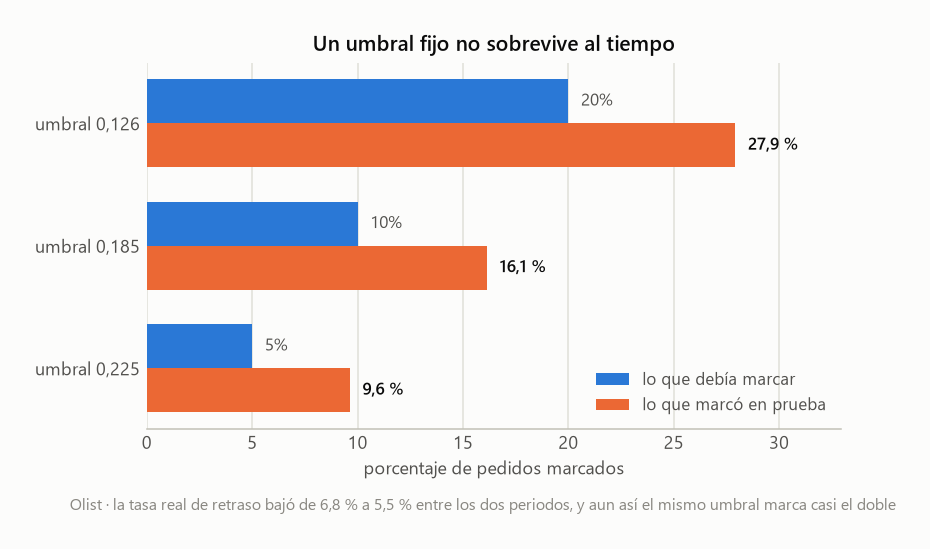
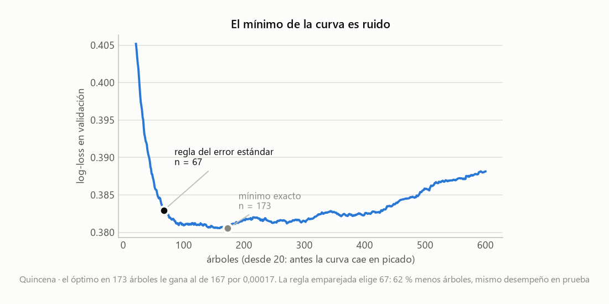
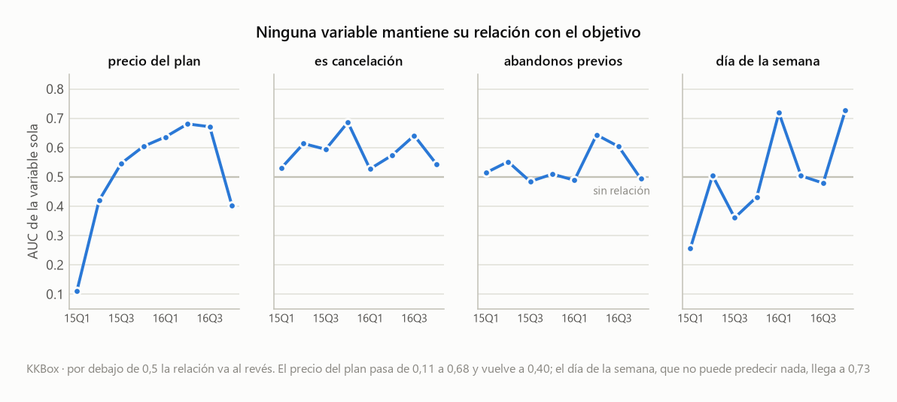
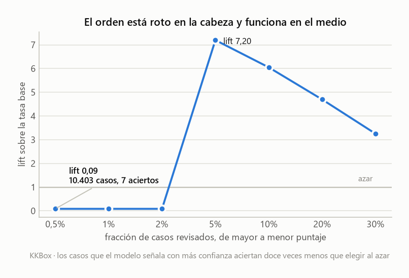

# A dataset-agnostic pipeline for entity-and-event problems

*[Léeme en español](README.md)*

There's a shape of problem that shows up in very different places. You have a table of
**entities** — customers, users, stores — and another of **events** that happen to them over
time: loans, orders, renewals. Each event carries a date and an outcome you'd like to call
ahead of time. Will this loan default? Will this order arrive late? Will this user renew next
month?

Change domain and the code gets rewritten from scratch, even though the skeleton of the
problem is identical. This repository is an attempt to write that skeleton once.

It started as a top-to-bottom script for a single case. That script is still here,
[`corrida_mono.py`](src/corrida_mono.py), uncorrected: the contrast with what came after
tells half the story. Out of it came a module where no line names a concrete column, plus
four configurations that use it on domains with nothing in common.

The name comes from the part that took the most work. `ConteoPrevio` and `SumaPrevia` compute
each entity's past — how many events it had before, and how many went badly — excluding the
current row **by construction**, not through a filter someone has to remember to add. There's
a test dedicated to proving it, and that test is itself verified by deliberately breaking the
code to check that it fails when it should.

The models this produces are mediocre, and that's fine. What's worth reading are three
things that broke along the way and could be measured:

**A probability threshold doesn't hold up over time.** The value 0.185 was picked on
validation to flag the riskiest 10 % of orders. Three months later, on test, that same number
was flagging 16.1 % — and the actual late-delivery rate had gone *down*, not up.
[See it ↓](#1-a-fixed-probability-threshold-does-not-survive-time)

**The minimum of the validation curve is noise, and the classic recipe for dodging it is
usually applied wrong.** The optimum at 173 trees beats the one at 167 by seventeen
hundred-thousandths. Fixing *which* standard error you compare brings the model down to 67
trees with nothing lost.
[See it ↓](#2-the-argmin-of-the-validation-curve-is-noise-and-the-standard-error-has-to-be-paired)

**A fourth case that didn't work, chased down to the cause.** AUC 0.91 on validation, 0.59 on
test. It turned out the target was measuring each row's position inside the data window, not
the user's behaviour.
[See it ↓](#a-fourth-case-and-what-it-taught-by-failing)



All three, step by step and with outputs embedded, in
**[`notebooks/findings.ipynb`](notebooks/findings.ipynb)**.

## The four cases

**Quincena** doesn't exist. The lender is invented, along with its 2,500 customers and its
6,897 loans, so there'd be a test bench anyone can regenerate from a fixed seed. The name comes from
*créditos de quincena*, payday loans in Colombia. What gets predicted is default: whether the
loan ended up paid more than thirty days late.

**Olist** is real. It's a Brazilian marketplace that connects small shops to the big sales
portals, and in 2018 it published a hundred thousand actual orders — purchase dates, delivery
dates, cities, and the date the customer had been promised. Here it's used to predict whether
an order will land after that promise. It's the only real-data case where the model works.

**KKBox** is a music streaming service, big in Taiwan and Southeast Asia. It released
twenty-one million subscription transactions for a churn prediction competition. It joined
the project for one specific reason: on Olist almost nobody buys twice, so the history
features had nothing to count. KKBox has a median of fifteen transactions per user. There
they did work — and the model failed for a different reason, which turned out to be the most
interesting part of all this.

**The fourth** is synthetic and exists for one test: checking that the module holds up on a
domain that looks like nothing that came before. Online-store users, purchase returns, columns
invented from scratch. If that runs without touching the core, the abstraction is doing its
job.

Each case's configuration lives in its own file, under [`src/casos/`](src/casos). The core,
[`src/nucleo/`](src/nucleo), does not name a single concrete column.

```python
exp = Experimento(
    relacion=Relacion(eventos=prestamos, entidades=clientes, llave="cliente_id"),
    corte=CorteTemporal("fecha_desembolso", "2025-08-01", "2025-10-01"),
    objetivo=Objetivo("mora"),
    numericas=["edad", "ingreso_mensual", "meses_empleo", "monto", "plazo_dias"],
    categoricas=["tipo_contrato", "ciudad"],
    derivadas=[
        Razon("cuota_ingreso", numerador="monto", denominador="ingreso_mensual"),
        ConteoPrevio("prestamos_previos", llave="cliente_id", fecha="fecha_desembolso"),
        SumaPrevia("moras_previas", llave="cliente_id", fecha="fecha_desembolso",
                   columna="mora"),
    ],
)
res = entrenar(exp)
```

> **A note on language.** The code, comments and docstrings are in Spanish; this file and
> the notebook are in English. Identifiers below are given as they appear in the source,
> and the notebook opens with a short glossary.

## Why it exists, when scikit-learn already has `Pipeline` and `GridSearchCV`

That's the first reasonable question, and the short answer is that scikit-learn solves the
modelling and leaves out the part people get wrong most often.

Three things come from here. The first is the two-table data model with a validated join: it
checks that keys on the entity side are unique and reports how many events ended up without
their entity, which is the kind of error that slips through quietly and contaminates
everything downstream.

The second is the one that actually justifies the work. `ConteoPrevio` and `SumaPrevia`
compute how many prior events an entity had and how many of those went wrong, and they
exclude the current row **by construction** — not through a filter someone has to remember
to add. In scikit-learn you write that by hand in every project, and that's exactly where the
present slips in unnoticed. There's a dedicated test proving it doesn't happen here.

The third is more modest: a complete case declared in one file you can read top to bottom,
kept apart from the process that runs it.

Now, the limits. It's agnostic about the **dataset**. Not about the algorithm, and not about
the task. It's married to boosting, because `elegir_n` depends on `staged_predict_proba` and
only models that grow by adding pieces have it. And it assumes binary classification in
several places. Changing either of those is a project, not a parameter.

## Running it

```bash
python -m venv .venv && .venv/Scripts/activate
pip install -r requirements.txt
pip install -e .                     # makes `nucleo` importable from anywhere
```

The editable install copies nothing: it writes a link to this folder. That is what lets the
cases do `from nucleo import ...` with no `sys.path` patch in every file.

**Two of the three cases run straight after cloning**, with nothing to download:

```bash
python src/generar_datos.py       # generates Quincena's synthetic data
python src/casos/quincena.py      # Quincena case
python src/casos/sintetico.py     # generates its own data and trains, another domain
```

The other two need Kaggle data:

```bash
# "Brazilian E-Commerce Public Dataset by Olist" ->
#   src/datasets/olist/olist_orders_dataset.csv
#   src/datasets/olist/olist_customers_dataset.csv
python src/casos/olist.py

# "WSDM - KKBox's Churn Prediction Challenge" ->
#   src/datasets/KKbox/transactions.csv      (1.65 GB, the full one is needed, not _v2)
#   src/datasets/KKbox/members_v3.csv
#   src/datasets/KKbox/train_v2.csv
# user_logs.csv is NOT needed; it is tens of GB
python src/casos/kkbox.py
```

## Results

| | Quincena | Synthetic | Olist |
|---|---|---|---|
| nature | **synthetic** | **synthetic** | **real** |
| domain | credit default | purchase returns | late delivery |
| training rows | 3,934 | 2,143 | 64,326 |
| target rate | 18.5 % | 33.5 % | 8.1 % |
| trees chosen | 67 | 43 | 266 |
| test AUC | 0.787 | 0.814 | **0.746** |
| test log-loss | 0.418 | 0.522 | **0.209** |

That table shouldn't be read straight across. The first two columns are synthetic data,
written on purpose in [`generar_datos.py`](src/generar_datos.py) and
[`sintetico.py`](src/casos/sintetico.py), with the signal put in by hand: threshold rules,
interactions, a bit of noise. Their AUC measures whether boosting recovers those rules. As predictive ability it means nothing; as a reproducible test bench it's worth a fair
amount, since anyone can regenerate them and get the same numbers.

Olist is the only real result, and its signal splits like this: 35 % the customer's postcode,
34 % their state, 26 % the promised delivery window. Put plainly, the model learned geography.
All three are known when the customer places the order; the columns that only appear
afterwards — `order_delivered_carrier_date`, `order_approved_at` — are left out on purpose,
because using them would be predicting the past from the future.

## Three findings worth more than the models

### 1. A fixed probability threshold does not survive time

An AUC of 0.746 says the model ranks orders by risk pretty well. Sounds usable. But calling
`predict()` on the 18,603 test rows, the model flags **ten**. Just ten. At an 8 % base rate
almost no order crosses the 0.5 threshold `predict()` uses by default, and the question "is it
more likely than not?" almost always answers no.

The useful decision is a different one: *if 10 % of the orders can be reviewed, how many late
deliveries does that catch?* That works — a lift of 3.1 over choosing at random. And checking it
properly turned up this:

| threshold chosen on validation | should flag | flagged on test |
|---|---|---|
| 0.225 | 5 % | **9.6 %** |
| 0.185 | 10 % | **16.1 %** |
| 0.126 | 20 % | **27.9 %** |

All three flag nearly double what was intended. And the disorienting part is that the actual
late-delivery rate had **gone down** between the two periods, from 6.8 % to 5.5 %.

Olist improved its deliveries over those months. The model never found out and kept scoring
on the scale of the period it learned in. Probabilities drift upward while reality gets
better, and if anyone had frozen that 0.185 in a real system, three months later they'd be
reviewing 60 % more orders than planned — with nothing failing and nothing warning them.

Hence the rule written into the docstring of `tabla_de_umbrales`: **fix the capacity, not the
probability.** "Review the top 10 % of today's batch" holds up under the drift, because it
depends only on the ordering and the ordering does hold. On test that gives 18.3 % precision
and catches a third of the late deliveries: 3.35 times better than random, slightly better
even than on validation.

### 2. The `argmin` of the validation curve is noise, and the standard error has to be paired

To decide how many trees to use you plot the validation error tree by tree and take the
lowest point. That's the usual move. The trouble is that the curve bottoms out and then goes
almost flat: on Quincena the minimum lands at 173 trees and beats the one at 167 by seventeen
hundred-thousandths. Picking that exact point is fitting the validation set's noise.

The classic remedy is the one-standard-error rule: keep the smallest model within one standard
error of the minimum. Applied as-is, it cut too hard — from 173 trees down to 29, and that
did cost measurable test performance.

The mistake was in *which* standard error. The one on the **level** of the loss measures how
uncertain the log-loss value is, which with a thousand validation rows is large. But what
needs comparing are **differences between nearby tree counts**, and there the two models
predict almost the same thing on the same rows: their errors are correlated and the difference
is estimated far more precisely. The right statistic is the standard error of the row-by-row
difference.

With that change, Quincena goes from 173 trees to 67 and Olist from 446 to 266, with test
performance equal or slightly better. Models two and three times smaller, for free.



### 3. What didn't work, which counts too

The history features, the most carefully built part of the module, were useless on Olist. 96.8 % of customers
bought exactly once, so `compras_previas` is zero on almost every row and ended up with 1.9 %
importance. All that work to measure a customer's past, on a dataset where customers don't
have one.

That dataset also hides a trap that is easy to fall into. `customer_id` in Olist is unique
**per order**, not per person; the person's identifier is `customer_unique_id`. With the
first one, the join validation passes without a murmur — the keys *are* unique — while the history
comes out zero across all 96,476 rows. No error, no warning, nothing. The fix wasn't in the
pipeline: the join uses `customer_id` and compute the history over `customer_unique_id`, and
the design allows it because they're two separate parameters.

Calendar features didn't help either. `dia_semana` and `hora` add less than 1 % between them,
which makes sense: Olist already accounts for weekends when it promises a delivery date, so
that effect was absorbed into a variable the model already had.

And the most uncomfortable result: the model beats the baseline by **5.5 %** of log-loss
(0.2217 against 0.2093). Predicting "8.11 % for everyone" is nearly as good in calibration
terms. It ranks well and calibrates badly, the usual picture with imbalanced classes.

## A fourth case, and what it taught by failing

KKBox joined the project to cover Olist's gap. If the history features couldn't be tested on
customers who buy once, what was needed was a dataset where the same entity shows up many
times. This one had them in abundance: 2.56 million labelled events, 186,246 users, a **median of fifteen
transactions per user**.

Half of it went well and the other half fell apart in a way nobody would have predicted.

### The part that worked

Importance here is measured by permutation: shuffle a column and see how much the AUC drops.
The bigger the drop, the more the model was leaning on it.

| variable | AUC drop |
|---|---|
| `payment_method_id` | 0.1804 |
| **`abandonos_previos`** (`SumaPrevia`) | **0.0445** |
| `plan_list_price` | 0.0441 |
| **`renovaciones_previas`** (`ConteoPrevio`) | **0.0221** |
| `dia_semana` | **−0.0163** |

`abandonos_previos` and `renovaciones_previas` make the top five. They come from the 1.9 %
combined they managed on Olist, so with real histories they do contribute. (Take `is_cancel`
out of the model and they climb to second and fourth, at 0.0414 and 0.0191 — their weight
depends on what else is competing.) The pipeline's machinery does its job; what was wrong was
how the target was framed, which is a different thing.

The negative numbers, like `dia_semana`, mean that shuffling that column *improves* the model:
it was leaning on noise.

One variable was left out on purpose, and it's worth explaining why, because the two
candidates were equally strong and only one went.

`is_auto_renew` says whether automatic billing is switched on. It came first by a wide margin,
and it's close to a tautology: the target asks "does another transaction appear?", and that
column says the system **will generate one on its own**. It doesn't predict churn. It's the
mechanism that produces the event the label is defined by. Dropping it cost 0.007 of AUC,
because `payment_method_id` carried the same information by another route.

`is_cancel` stayed. It's also strong, but it describes a user action, and it isn't
deterministic either: 77 % of the people who cancel come back. It also turned out to be the
only strong variable that keeps its sign between validation and test, 0.641 and 0.568, while
`plan_list_price` goes from 0.671 to 0.553 inverted. Dropping it sinks test AUC from 0.59 to
0.51 — it was the little that generalised.

### The part that fell apart

```
validation AUC 0.9101      test AUC 0.5939
```

Ninety-one against fifty-nine. That isn't the kind of overfitting you fix by regularising:
it's something breaking between one period and the next.

The first reasonable suspicion is variable selection, so it was ruled out by measuring:

| variables | columns | validation AUC | test AUC |
|---|---|---|---|
| all | 77 | 0.9190 | 0.5988 |
| without city, gender, channel | 47 | 0.9161 | 0.5952 |
| also without `is_auto_renew` | 46 | 0.9089 | 0.5957 |

Thirty columns out and nothing happens. The most important variable out, and nothing either.
Test AUC stays pinned at 0.595 under every combination. If the problem lived in which
variables go in, moving them would have some effect.

What did explain everything was measuring each variable's AUC **on its own, quarter by
quarter**. None holds its relationship with the target: `plan_list_price` goes from 0.112 —
inverted — up to 0.681, and back to 0.403. `antiguedad_dias` goes from 0.726 to 0.331.

And `dia_semana` reaches 0.727 in one quarter. That's the giveaway: day of week cannot predict
churn by any plausible mechanism, so if it does, it's picking up an artefact.



The showiest symptom is in the threshold table. The model flags 10,403 cases as highest risk,
at a predicted probability of 78 %. **Seven** of them churn. A lift of 0.086: twelve times
worse than flipping a coin. And all 10,403 rows share exactly the same probability, because
they all come out of a single tree leaf.

Meanwhile at 5 % capacity the lift is **7.20**. Ordering is broken at the head and works very
well in the middle, and no aggregate number shows you that — neither AUC nor log-loss.



### The cause

It's in how the target ended up defined, and it doesn't jump out.

`abandona` is 1 when there's no other transaction from the same user within thirty days after
their subscription expires. Sounds reasonable. But applied to someone with fifteen renewals
in a row, that's only true on **their last observed transaction**.

So the target isn't measuring "this user is about to leave". It's largely measuring "this is
this user's last row inside the data window" — a property of the file, not of the person.
Which is why the model learns position in the sequence, why that works inside a similar
period, and why it collapses when you cross into another.

Two more measurements confirm the picture. First: the censoring filter, which drops
rows whose outcome can't be observed yet, **doesn't drop at random**. It goes from 1 % in
November 2016 to 22.8 % in December and 98.8 % in January, and it takes mostly the long plans,
because those expire latest. In the test partition, plans longer than forty days ended up at
0.015 %; in training they were 0.524 %. Second: training on recent data only barely helps,
0.596 to 0.619, so it isn't that the old data has gone stale.

KKBox's original competition framed the problem differently: **one prediction per user at a
fixed date** — those expiring in February 2017 — not one per transaction. That framing dodges
the artefact, because if every row sits at the same point in the calendar, position in the
sequence stops being privileged information. It's a different problem and this pipeline
doesn't support it.

It's documented as a real limit of the design: this works for events that carry their own
date, and not for survival-style targets. The case is complete and runnable in
[`src/casos/kkbox.py`](src/casos/kkbox.py); its output reproduces the whole diagnosis.

## Tests

```bash
python -m pytest -q          # 23 tests, ~1 s
```

CI runs them on every push against Python 3.12 and 3.14, the project's real floor and the
version it was developed on. It also runs **both synthetic cases end to end**: since they
generate their own data, no Kaggle download is needed, so what gets verified is the full
pipeline and not just the pure functions.

They cover the pure functions and, above all, **the error messages**: half the module's
value is in failing early and with context, and that breaks as easily as a calculation.

The most important test is `test_suma_previa_no_se_cuenta_a_si_misma`: it proves by
construction that the history feature cannot see its own answer. If someone "optimised"
`SumaPrevia` by removing the `- orden[self.columna]`, the result would go from `[0, 1, 1]`
to `[1, 1, 2]` and the test catches it.

The three key tests were verified by mutation — deliberately breaking the code in a copy of
the module — to confirm they fail when they should:

| mutation | caught? |
|---|---|
| `SumaPrevia` counts itself | yes |
| `ConteoPrevio` trusts the file's row order | yes |
| `Razon` lets infinity through | yes |

## Layout

```
pyproject.toml             declares nucleo and casos as packages; src/ is the source root
src/
  nucleo/                  what does NOT change between cases
    __init__.py            declares the public surface
    pipeline.py            names no concrete column
  casos/                   one instance of the same pattern per domain
    quincena.py            credit default (synthetic)
    sintetico.py           purchase returns (synthetic, generates itself)
    olist.py               late delivery (real, Kaggle data)
    kkbox.py               subscription churn (runs, but does not generalise)
  generar_datos.py         generates Quincena's synthetic data
  figuras.py               regenerates this README's figures
  corrida_mono.py          the original monolithic version, kept on purpose
  datasets/                data, outside the repository
notebooks/
  findings.ipynb           the three findings, step by step, outputs embedded
tests/
  test_pipeline.py         23 tests of the pure functions and the error messages
figuras/                   versioned PNGs, regenerable with src/figuras.py
.github/workflows/         CI: tests plus both synthetic cases end to end
```

The layout is the argument: `nucleo/` and `casos/` are separate because that separation
**is** the design. `corrida_mono.py` sits loose in `src/`, outside the structure, so it
reads as what it is: the starting point, not part of the design.

### The module's pieces

| piece | what it does |
|---|---|
| `Tabla`, `Relacion` | which files load and how they join |
| `Variable` (`Protocol`) | a derived feature's contract: `nombre` + `calcular(df)` |
| `Razon`, `ConteoPrevio`, `SumaPrevia`, `DiferenciaDias`, `ParteDeFecha` | the implementations |
| `CorteTemporal` | train / validation / test by date, with validations |
| `Objetivo`, `ConfigModelo` | what is predicted and with which knobs |
| `Experimento` | assembles all of the above and validates on construction |
| `entrenar(exp)` | returns a `Resultado` |
| `elegir_n` | the number of trees, by paired standard error |
| `tabla_de_umbrales` | what you catch when reviewing each fraction of the cases |
| `importancias` | by impurity reduction or by permutation, depending on the engine |

`Variable` is a `Protocol`: you don't inherit from it, you match its shape. The five
implementations share no line of code, and the module that uses them has not a single `if`
to tell them apart. Adding the two Olist needed cost **nine lines each and zero changes** to
`entrenar`, `construir_tabla` or `construir_pipeline`.

## Design decisions worth pointing out

- **Preprocessing lives inside the `Pipeline`.** The imputer's median and the
  `OneHotEncoder`'s categories are learned from training only. Putting it outside is the
  most common leak, and the quietest.
- **The test set is touched once**, at the end. The threshold and the tree count are chosen
  on validation.
- **Validations fail early and with context.** If the split dates don't match the data, the
  error names the empty partitions and the real range; if a column doesn't exist, it lists
  them all at once; if the date column arrived as text, it says exactly what to write.
- **Two engines**: `GradientBoostingClassifier` (exact) and `HistGradientBoostingClassifier`
  (histogram). The second turned out **about 100 times faster** on 1.7 million rows — from
  167 minutes to 1.6 — because it bins each variable into 256 buckets instead of evaluating
  every possible split.
- **Two selection criteria**: `log_loss` and `auc`. The second exists because when the base
  rate shifts between partitions, log-loss is dominated by the level mismatch and `elegir_n`
  stops at the first tree. AUC only looks at the ordering.

## Known gaps

- **Recalibration as an alternative to the AUC criterion.** The base-rate shift is, on a log
  scale, purely an intercept shift. Correcting it before computing log-loss would restore
  the metric's meaning and keep the paired-standard-error machinery, which is the module's
  most solid part.
- **`OneHotEncoder` without `min_frequency`.** Olist's `customer_city` has 4,085 values and
  was left out for that reason.
- **Imbalance.** At 8 % positives the model never predicts the minority class, and
  `GradientBoostingClassifier` does not accept `class_weight`. The adopted way out is not
  using `predict()` and working with capacity-based thresholds instead.
