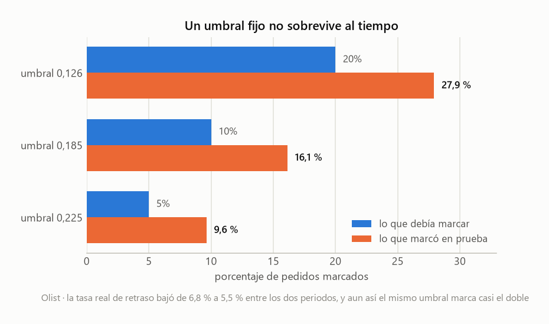
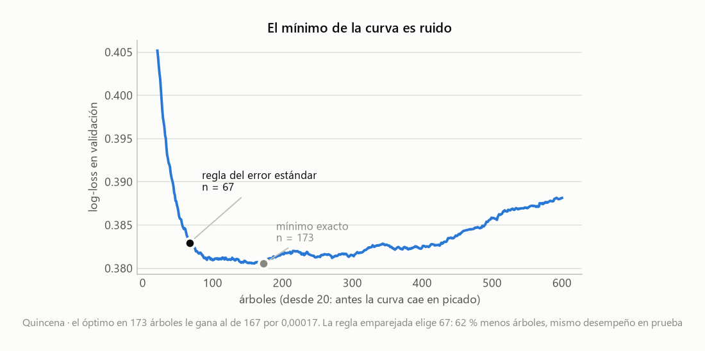
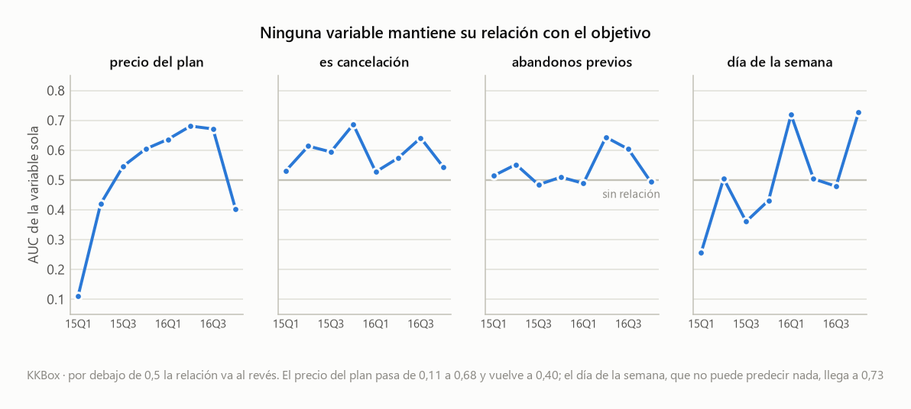
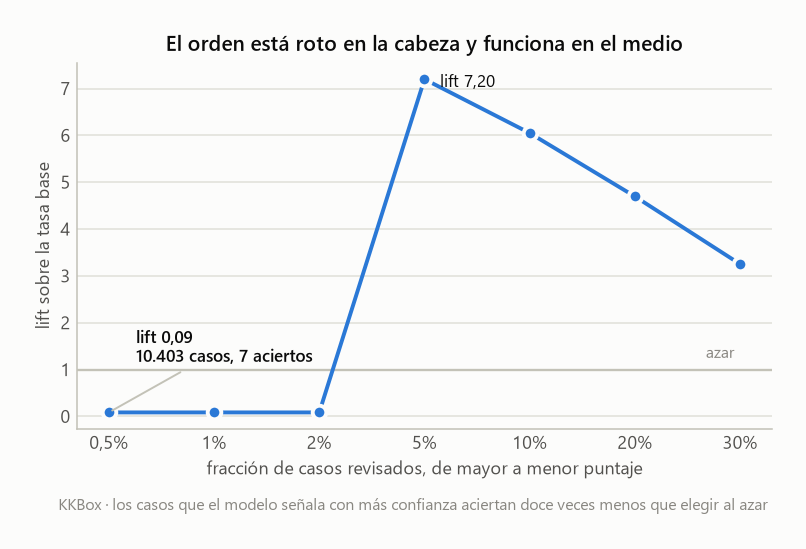

# Pipeline agnóstico para problemas de entidades y eventos

*[Read this in English](README.en.md)*

Hay una forma de problema que reaparece en sitios muy distintos. Tienes una tabla de
**entidades** —clientes, usuarios, tiendas— y otra de **eventos** que les van ocurriendo con
el tiempo: préstamos, pedidos, renovaciones. Cada evento trae su fecha y un desenlace que
querrías anticipar. ¿Este préstamo se va a ir a mora? ¿Este pedido llegará tarde? ¿Este
usuario renovará el mes que viene?

Cambias de dominio y el código se rehace entero, aunque el esqueleto del problema sea
exactamente el mismo. Este repositorio es un intento de escribir ese esqueleto una sola vez.

Empezó como un script de arriba abajo para un único caso. Ese script todavía está aquí,
[`corrida_mono.py`](src/corrida_mono.py), sin corregir: el contraste con lo que vino después
cuenta la mitad de la historia. De ahí salió un módulo donde ninguna línea menciona una
columna concreta, y cuatro configuraciones que lo usan sobre dominios que no comparten nada.

El nombre viene de la parte que más trabajo costó. `ConteoPrevio` y `SumaPrevia` calculan el
pasado de cada entidad —cuántos eventos tuvo antes y cuántos salieron mal— excluyendo la fila
actual **por construcción**, no por un filtro que alguien tenga que acordarse de poner. Hay
una prueba dedicada a demostrarlo, y está verificada rompiendo el código a propósito para
comprobar que falla cuando debe.

Los modelos que salen de todo esto son mediocres, y eso está bien. Lo que vale la pena leer
son tres cosas que se rompieron por el camino y se pudieron medir:

**Un umbral de probabilidad no aguanta el tiempo.** El valor 0,185 salió de validación para
marcar el 10 % de los pedidos más riesgosos. Tres meses después, en prueba, ese mismo número
marcaba el 16,1 % — y la tasa real de retraso había bajado, no subido.
[Cómo se ve ↓](#1-un-umbral-fijo-de-probabilidad-no-sobrevive-al-tiempo)

**El mínimo de la curva de validación es ruido, y la receta clásica para esquivarlo está mal
aplicada casi siempre.** El punto óptimo en 173 árboles le gana al de 167 por diecisiete
cienmilésimas. Al corregir qué error estándar se compara, el modelo baja a 67 árboles sin
perder nada. [Cómo se ve ↓](#2-el-argmin-de-la-curva-de-validación-es-ruido-y-el-error-estándar-hay-que-emparejarlo)

**Un cuarto caso que no funcionó, perseguido hasta la causa.** AUC de 0,91 en validación y
0,59 en prueba. Resultó que el objetivo estaba midiendo la posición de cada fila dentro de la
ventana de datos, y no el comportamiento del usuario.
[Cómo se ve ↓](#un-cuarto-caso-y-lo-que-enseñó-al-no-funcionar)



Los tres, paso a paso y con las salidas dentro, en
**[`notebooks/findings.ipynb`](notebooks/findings.ipynb)** — en inglés, porque es el
artefacto que más se comparte y no debería tener muro de idioma.

## Los cuatro casos

**Quincena** no existe. La financiera está inventada, junto con sus 2.500 clientes y sus
6.897 préstamos, para tener un banco de pruebas que cualquiera pueda regenerar con una
semilla fija. El nombre viene de los créditos de quincena, los que se pagan el día de pago.
Lo que se predice es la mora: si el préstamo terminó pagándose con más de treinta días de
retraso.

**Olist** sí existe. Es un marketplace brasileño que conecta comercios pequeños con los
grandes portales de venta, y en 2018 publicó cien mil pedidos reales: fechas de compra,
fechas de entrega, ciudades, y la fecha que se le había prometido al cliente. Aquí se usa
para predecir si un pedido llegará después de esa promesa. Es el único caso con datos reales
donde el modelo funciona.

**KKBox** es un servicio de streaming de música, grande en Taiwán y el sudeste asiático.
Publicó veintiún millones de transacciones de suscripción para una competencia de predicción
de abandono. Entró al proyecto por un motivo concreto: en Olist casi nadie compra dos veces,
así que las variables de historial se quedaron sin nada que contar. KKBox tiene una mediana
de quince transacciones por usuario. Ahí sí funcionaron — y el modelo falló por otra razón,
que resultó ser lo más interesante de todo.

**El cuarto** es sintético y existe solo para una prueba: comprobar que el módulo aguanta un
dominio que no se parece a nada de lo anterior. Usuarios de una tienda en línea,
devoluciones de compras, columnas inventadas desde cero. Si eso corre sin tocar el núcleo, la
abstracción sirve.

La configuración de cada caso vive en su propio archivo, dentro de [`src/casos/`](src/casos).
El núcleo, [`src/nucleo/`](src/nucleo), no menciona ni una sola columna concreta.

```python
exp = Experimento(
    relacion=Relacion(eventos=prestamos, entidades=clientes, llave="cliente_id"),
    corte=CorteTemporal("fecha_desembolso", "2025-08-01", "2025-10-01"),
    objetivo=Objetivo("mora"),
    numericas=["edad", "ingreso_mensual", "meses_empleo", "monto", "plazo_dias"],
    categoricas=["tipo_contrato", "ciudad"],
    derivadas=[
        Razon("cuota_ingreso", numerador="monto", denominador="ingreso_mensual"),
        ConteoPrevio("prestamos_previos", llave="cliente_id", fecha="fecha_desembolso"),
        SumaPrevia("moras_previas", llave="cliente_id", fecha="fecha_desembolso",
                   columna="mora"),
    ],
)
res = entrenar(exp)
```

## Por qué existe, si scikit-learn ya tiene `Pipeline` y `GridSearchCV`

Es la primera pregunta razonable, y la respuesta corta es que scikit-learn resuelve el
modelado y deja fuera la parte que más se equivoca.

Lo que aporta esto son tres cosas. La primera es el modelo de datos de dos tablas, con la
unión validada: comprueba que las llaves del lado de las entidades sean únicas y reporta
cuántos eventos se quedaron sin su entidad, que es la clase de error que se cuela en
silencio y contamina todo lo demás.

La segunda es la que de verdad justifica el trabajo. `ConteoPrevio` y `SumaPrevia` calculan
cuántos eventos previos tuvo esa entidad y cuántos de ellos salieron mal, y excluyen la fila
actual **por construcción** — no por un filtro que alguien recuerde poner. En scikit-learn
eso se escribe a mano en cada proyecto, y ahí es facilísimo colar el presente sin darse
cuenta. Hay una prueba dedicada a demostrar que no ocurre.

La tercera es más modesta: un caso completo declarado en un archivo que se lee de arriba
abajo, separado del proceso que lo ejecuta.

Ahora, los límites. Es agnóstico respecto al **dataset**. No respecto al algoritmo, ni a la
tarea. Está casado con el boosting, porque `elegir_n` depende de `staged_predict_proba` y eso
solo lo tienen los modelos que crecen sumando piezas. Y asume clasificación binaria en varios
sitios. Cambiar cualquiera de las dos cosas es un proyecto, no un parámetro.

## Cómo correrlo

```bash
python -m venv .venv && .venv/Scripts/activate
pip install -r requirements.txt
pip install -e .                     # deja `nucleo` importable desde cualquier sitio
```

La instalación editable no copia nada: escribe un enlace a esta carpeta. Es lo que permite
que los casos hagan `from nucleo import ...` sin parches de `sys.path` en cada archivo.

**Dos de los tres casos corren recién clonado el repositorio**, sin descargar nada:

```bash
python src/generar_datos.py       # genera los datos sintéticos de Quincena
python src/casos/quincena.py      # caso Quincena
python src/casos/sintetico.py     # genera sus datos y entrena, otro dominio
```

Los otros dos necesitan datos de Kaggle:

```bash
# "Brazilian E-Commerce Public Dataset by Olist" ->
#   src/datasets/olist/olist_orders_dataset.csv
#   src/datasets/olist/olist_customers_dataset.csv
python src/casos/olist.py

# "WSDM - KKBox's Churn Prediction Challenge" ->
#   src/datasets/KKbox/transactions.csv      (1,65 GB, hace falta el completo, no el _v2)
#   src/datasets/KKbox/members_v3.csv
#   src/datasets/KKbox/train_v2.csv
# NO hace falta user_logs.csv, que son decenas de GB
python src/casos/kkbox.py
```

## Resultados

| | Quincena | Ejemplo | Olist |
|---|---|---|---|
| naturaleza | **sintético** | **sintético** | **real** |
| dominio | mora crediticia | devolución de compras | entrega tardía |
| filas de entrenamiento | 3.934 | 2.143 | 64.326 |
| tasa del objetivo | 18,5 % | 33,5 % | 8,1 % |
| árboles elegidos | 67 | 43 | 266 |
| AUC en prueba | 0,787 | 0,814 | **0,746** |
| log-loss en prueba | 0,418 | 0,522 | **0,209** |

Conviene no leer esa tabla de corrido. Las dos primeras columnas son datos sintéticos,
escritos a propósito en [`generar_datos.py`](src/generar_datos.py) y
[`sintetico.py`](src/casos/sintetico.py), con la señal metida a mano: reglas de umbral,
interacciones, un poco de ruido. Su AUC mide si el boosting recupera esas reglas. Como
capacidad predictiva no significa nada; como banco de pruebas reproducible vale bastante,
porque cualquiera puede regenerarlos y obtener los mismos números.

Olist es el único resultado real, y su señal se reparte así: 35 % el código postal del
cliente, 34 % su estado, 26 % el plazo de entrega prometido. Dicho en corto, el modelo
aprendió geografía. Las tres variables se conocen cuando el cliente hace el pedido; las
columnas que solo aparecen después —`order_delivered_carrier_date`, `order_approved_at`—
quedan fuera a propósito, porque usarlas sería predecir el pasado con el futuro.

## Tres hallazgos que valen más que los modelos

### 1. Un umbral fijo de probabilidad no sobrevive al tiempo

Un AUC de 0,746 dice que el modelo ordena bien los pedidos por riesgo. Suena utilizable. Pero
al llamar a `predict()` sobre las 18.603 filas de prueba, el modelo señala **diez**. Solo
diez. Con una tasa base del 8 %, casi ningún pedido cruza el umbral de 0,5 que usa
`predict()` por defecto, y la pregunta «¿es más probable que sí a que no?» casi siempre tiene
respuesta «no».

La decisión útil es otra: *si puedo revisar el 10 % de los pedidos, ¿cuántos retrasos
atrapo?*. Eso funciona — un lift de 3,1 sobre elegir al azar. Y al comprobarlo con calma
apareció esto:

| umbral elegido en validación | debía marcar | marcó en prueba |
|---|---|---|
| 0,225 | 5 % | **9,6 %** |
| 0,185 | 10 % | **16,1 %** |
| 0,126 | 20 % | **27,9 %** |

Los tres marcan casi el doble de lo previsto. Y lo desconcertante es que la tasa real de
retraso había **bajado** entre los dos periodos, de 6,8 % a 5,5 %.

Olist mejoró sus entregas durante esos meses. El modelo no se enteró y siguió puntuando con
la escala del periodo en que aprendió. Las probabilidades derivan hacia arriba mientras la
realidad mejora, y si alguien hubiera fijado ese 0,185 en un sistema de verdad, tres meses
después estaría revisando un 60 % más de pedidos de los que planeó — sin que nada fallara ni
avisara.

De ahí la regla que quedó escrita en el docstring de `tabla_de_umbrales`: **fijar la
capacidad, no la probabilidad.** «Revisar el 10 % con mayor puntaje del lote de hoy» aguanta
la deriva, porque solo depende del orden y el orden sí se mantiene. Sobre prueba eso da un
18,3 % de precisión y atrapa un tercio de los retrasos: 3,35 veces mejor que el azar, algo
mejor incluso que en validación.

### 2. El `argmin` de la curva de validación es ruido, y el error estándar hay que emparejarlo

Para decidir cuántos árboles usar se traza el error en validación árbol a árbol y se toma el
punto más bajo. Eso es lo habitual. El problema es que la curva llega abajo y se queda casi
plana: en Quincena el mínimo cae en 173 árboles y le gana al de 167 por diecisiete
cienmilésimas. Elegir ese punto exacto es ajustarse al ruido del conjunto de validación.

La receta clásica para eso es la regla de un error estándar: quedarse con el modelo más
pequeño que esté dentro de un error estándar del mínimo. Aplicada tal cual, recortaba
demasiado — de 173 árboles bajaba a 29, y eso sí costaba desempeño medible en prueba.

El error estaba en qué error estándar. El del **nivel** de la pérdida mide la incertidumbre
de cuánto vale el log-loss, que con mil filas de validación es grande. Pero lo que hay que
comparar son **diferencias entre dos números de árboles cercanos**, y ahí los dos modelos
predicen casi lo mismo sobre las mismas filas: sus errores están correlacionados y la
diferencia se estima con mucha más precisión. El estadístico que corresponde es el error
estándar de la diferencia fila a fila.

Con ese cambio, Quincena pasa de 173 árboles a 67 y Olist de 446 a 266, con el desempeño en
prueba igual o algo mejor. Modelos dos y tres veces más pequeños, gratis.



### 3. Lo que no funcionó, que también cuenta

Las variables de historial, que son la parte de la que estoy más satisfecho, en Olist no
sirvieron para nada. El 96,8 % de los clientes compró una sola vez, así que
`compras_previas` vale cero en casi todas las filas y acabó con un 1,9 % de importancia.
Todo ese trabajo para medir el pasado de un cliente, sobre un dataset donde los clientes no
tienen pasado.

Ese dataset esconde además una trampa fácil de pisar. `customer_id` en Olist es único **por
orden**, no por persona; el identificador de la persona es `customer_unique_id`. Con el
primero, la validación de la unión pasa sin una queja —las llaves son únicas, es verdad— y
el historial da cero en las 96.476 filas. Sin error, sin aviso, sin nada. La solución no
estuvo en tocar el pipeline: se une por `customer_id` y se calcula el historial sobre
`customer_unique_id`, y el diseño lo permite porque son dos parámetros distintos.

Las variables de calendario tampoco aportaron. `dia_semana` y `hora` suman menos del 1 %
entre las dos, y tiene sentido: Olist ya cuenta los fines de semana al prometer la fecha de
entrega, así que ese efecto está absorbido en una variable que el modelo ya tenía.

Y el resultado más incómodo: el modelo le gana al baseline por un **5,5 %** de log-loss
(0,2217 contra 0,2093). Predecir «8,11 % para todos» es casi tan bueno en términos de
calibración. Ordena bien y calibra mal, que es el retrato de siempre con clases
desbalanceadas.

## Un cuarto caso, y lo que enseñó al no funcionar

KKBox entró al proyecto para cubrir el hueco de Olist. Si las variables de historial no se
podían probar con clientes que compran una vez, hacía falta un dataset donde la misma
entidad apareciera muchas veces. Este los tenía de sobra: 2,56 millones de eventos
etiquetados, 186.246 usuarios, una **mediana de quince transacciones por usuario**.

La mitad salió bien y la otra mitad se desmoronó de una forma que nadie habría previsto.

### La parte que funcionó

La importancia aquí se mide por permutación: se baraja una columna y se mira cuánto empeora
el AUC. Cuanto más cae, más dependía el modelo de ella.

| variable | caída de AUC |
|---|---|
| `payment_method_id` | 0,1804 |
| `is_cancel` | 0,1262 |
| `plan_list_price` | 0,0158 |
| **`abandonos_previos`** (`SumaPrevia`) | **0,0144** |
| **`renovaciones_previas`** (`ConteoPrevio`) | **0,0091** |
| `dia_semana` | **−0,0163** |

`abandonos_previos` y `renovaciones_previas` entran en el top cinco. Vienen del 1,9 %
combinado que sacaban en Olist, así que con historiales de verdad sí aportan. (Si se quita
`is_cancel` del modelo suben a segunda y cuarta posición, con 0,0414 y 0,0191 — su peso
depende de qué más haya compitiendo.) La maquinaria del pipeline hace lo que debe; lo que
estaba mal era el planteamiento del objetivo, que es otra cosa.

Los números negativos, como el de `dia_semana`, significan que barajar esa columna *mejora*
el modelo: se estaba apoyando en ruido.

Hay una variable excluida a propósito, y vale la pena explicar por qué, porque las dos
candidatas eran igual de fuertes y solo una se fue.

`is_auto_renew` indica si el cobro automático está activado. Salía primera por goleada, y es
casi una tautología: el objetivo pregunta «¿aparece otra transacción?», y esa columna dice
que el sistema **la va a generar solo**. No predice el abandono. Es el mecanismo que produce
el evento con el que está definida la etiqueta. Quitarla costó 0,007 de AUC, porque
`payment_method_id` llevaba la misma información por otra vía.

`is_cancel` se quedó. También es fuerte, pero describe una acción del usuario, y además no es
determinista: el 77 % de quienes cancelan vuelven. Y resultó ser la única variable fuerte que
mantiene su signo entre validación y prueba, 0,641 y 0,568, mientras `plan_list_price` pasa
de 0,671 a 0,553 invertida. Quitarla hunde el AUC de prueba de 0,59 a 0,51 — era lo poco que
generalizaba.

### La parte que se desmoronó

```
AUC validación 0,9101      AUC prueba 0,5939
```

Novecientos y pico contra cincuenta y nueve. Eso no es sobreajuste del que se arregla
regularizando: es algo que se rompe entre un periodo y el siguiente.

La primera sospecha razonable es la selección de variables, así que quedó descartada
midiendo:

| variables | columnas | AUC validación | AUC prueba |
|---|---|---|---|
| todas | 77 | 0,9190 | 0,5988 |
| sin ciudad, género ni canal | 47 | 0,9161 | 0,5952 |
| también sin `is_auto_renew` | 46 | 0,9089 | 0,5957 |

Treinta columnas fuera y no pasa nada. La variable más importante fuera, y tampoco. El AUC
de prueba se queda clavado en 0,595 con cualquier combinación. Si el problema estuviera en
qué variables entran, moverlas tendría algún efecto.

Lo que sí lo explicó todo fue medir el AUC de cada variable **por separado y trimestre a
trimestre**. Ninguna mantiene su relación con el objetivo: `plan_list_price` va de 0,112
—relación invertida— hasta 0,681, y vuelve a 0,403. `antiguedad_dias` va de 0,726 a 0,331.

Y `dia_semana` llega a 0,727 en un trimestre. Esa es la pista definitiva: el día de la
semana no puede predecir un abandono por ningún mecanismo plausible, así que si lo hace,
está capturando un artefacto.



El síntoma más vistoso aparece en la tabla de umbrales. El modelo señala 10.403 casos como
los de mayor riesgo, con una probabilidad predicha del 78 %. De esos abandonan **siete**. Un
lift de 0,086: doce veces peor que tirar una moneda. Y las 10.403 filas comparten
exactamente la misma probabilidad, porque salen todas de una única hoja del árbol.

Mientras que al 5 % de capacidad el lift es de **7,20**. El orden está roto en la cabeza y
funciona muy bien en el medio, y eso no lo deja ver ningún número agregado — ni el AUC ni el
log-loss.



### La causa

Está en cómo quedó definido el objetivo, y no salta a la vista.

`abandona` vale 1 cuando no hay otra transacción del mismo usuario dentro de los treinta días
posteriores al vencimiento de su suscripción. Suena razonable. Pero aplicado a alguien con
quince renovaciones seguidas, eso solo es cierto en **su última transacción observada**.

Así que el objetivo no está midiendo «este usuario se va a ir». Está midiendo, en buena
parte, «esta es la última fila de este usuario dentro de la ventana de datos» — una propiedad
del archivo, no de la persona. De ahí que el modelo aprenda posición en la secuencia, que eso
funcione dentro de un periodo parecido y se desmorone al cruzar a otro.

Dos mediciones más confirman el cuadro. La primera: el filtro de censura, que descarta
las filas cuyo desenlace todavía no se puede observar, **no descarta al azar**. Pasa del 1 %
en noviembre de 2016 al 22,8 % en diciembre y al 98,8 % en enero, y se lleva sobre todo los
planes largos, porque son los que vencen más tarde. En la partición de prueba los planes de
más de cuarenta días quedaron en el 0,015 %; en entrenamiento eran el 0,524 %. La segunda:
entrenar solo con datos recientes apenas ayuda, de 0,596 a 0,619, así que tampoco es que los
datos viejos estén rancios.

La competencia original de KKBox planteaba el problema de otra manera: **una predicción por
usuario en una fecha fija** —los que vencían en febrero de 2017—, no una por transacción. Ese
planteamiento esquiva el artefacto, porque si todas las filas están en el mismo punto del
calendario, la posición en la secuencia deja de ser información privilegiada. Es un problema
distinto y este pipeline no lo soporta.

Queda documentado como un límite real del diseño: esto sirve para eventos que tienen su propia
fecha, y no para objetivos de supervivencia. El caso está completo y ejecutable en
[`src/casos/kkbox.py`](src/casos/kkbox.py); su salida reproduce el diagnóstico entero.

## Pruebas

```bash
python -m pytest -q          # 23 pruebas, ~1 s
```

El CI las corre en cada push sobre Python 3.12 y 3.14, que son el piso real del proyecto y
la versión en la que se desarrolló. Y además ejecuta **los dos casos sintéticos de punta a
punta**: como se generan solos, no hacen falta datos de Kaggle, así que lo que se verifica
no son solo las funciones puras sino el pipeline completo.

Cubren las funciones puras y, sobre todo, **los mensajes de error**: la mitad del valor del
módulo está en fallar temprano y con contexto, y eso se rompe con la misma facilidad que una
cuenta.

La prueba que más importa es `test_suma_previa_no_se_cuenta_a_si_misma`: demuestra por
construcción que la variable de historial no ve su propia respuesta. Si alguien
«optimizara» `SumaPrevia` quitándole el `- orden[self.columna]`, el resultado pasaría de
`[0, 1, 1]` a `[1, 1, 2]` y la prueba lo caza.

Las tres pruebas clave se verificaron por mutación —rompiendo el código a propósito en una
copia del módulo— para confirmar que fallan cuando deben:

| mutación | ¿la detecta? |
|---|---|
| `SumaPrevia` se cuenta a sí misma | sí |
| `ConteoPrevio` confía en el orden del archivo | sí |
| `Razon` deja pasar el infinito | sí |

## Estructura

```
pyproject.toml             declara nucleo y casos como paquetes; src/ es la raíz de código
src/
  nucleo/                  lo que NO cambia entre casos
    __init__.py            declara la superficie pública
    pipeline.py            no menciona ninguna columna concreta
  casos/                   una instancia del mismo patrón por dominio
    quincena.py            mora crediticia (sintético)
    sintetico.py           devoluciones de compras (sintético, se genera solo)
    olist.py               entrega tardía (real, datos de Kaggle)
    kkbox.py               abandono de suscripciones (corre, pero no generaliza)
  generar_datos.py         genera los datos sintéticos de Quincena
  figuras.py               regenera las figuras de este README
  corrida_mono.py          la versión monolítica original, conservada a propósito
  datasets/                datos, fuera del repositorio
notebooks/
  findings.ipynb           los tres hallazgos paso a paso, con las salidas dentro (en inglés)
tests/
  test_pipeline.py         23 pruebas de las funciones puras y de los mensajes de error
figuras/                   PNG versionados, regenerables con src/figuras.py
.github/workflows/         CI: pruebas y los dos casos sintéticos de punta a punta
```

La estructura es el argumento: `nucleo/` y `casos/` están separados porque esa separación
**es** el diseño. `corrida_mono.py` se queda suelto en `src/`, fuera de la estructura, para
que se lea como lo que es: el punto de partida, no parte del diseño.

### Las piezas del módulo

| pieza | qué hace |
|---|---|
| `Tabla`, `Relacion` | qué archivos se cargan y cómo se unen |
| `Variable` (`Protocol`) | el contrato de una variable derivada: `nombre` + `calcular(df)` |
| `Razon`, `ConteoPrevio`, `SumaPrevia`, `DiferenciaDias`, `ParteDeFecha` | las implementaciones |
| `CorteTemporal` | entrenamiento / validación / prueba por fecha, con validaciones |
| `Objetivo`, `ConfigModelo` | qué se predice y con qué perillas |
| `Experimento` | junta todo lo anterior y lo valida al construirse |
| `entrenar(exp)` | devuelve un `Resultado` |
| `elegir_n` | el número de árboles, por error estándar emparejado |
| `tabla_de_umbrales` | qué se atrapa al revisar cada fracción de los casos |
| `importancias` | por reducción de impureza o por permutación, según lo que el motor permita |

`Variable` es un `Protocol`: no se hereda de él, se le cumple la forma. Las cinco
implementaciones no comparten una línea de código y el módulo que las usa no tiene un solo
`if` para distinguirlas. Añadir las dos que Olist necesitó costó **nueve líneas cada una y
cero cambios** en `entrenar`, `construir_tabla` o `construir_pipeline`.

## Decisiones de diseño que conviene señalar

- **El preprocesamiento vive dentro del `Pipeline`.** La mediana del imputador y las
  categorías del `OneHotEncoder` se aprenden solo con entrenamiento. Ponerlo fuera es la
  fuga más común y la más silenciosa.
- **El conjunto de prueba se toca una sola vez**, al final. El umbral y el número de árboles
  se eligen con validación.
- **Las validaciones fallan temprano y con contexto.** Si las fechas de corte no calzan con
  los datos, el error nombra las particiones vacías y el rango real; si una columna no
  existe, los lista todos de una vez; si la columna de fecha llegó como texto, dice qué
  escribir para arreglarlo.
- **Dos motores**: `GradientBoostingClassifier` (exacto) y `HistGradientBoostingClassifier`
  (histograma). El segundo resultó **unas 100 veces más rápido** sobre 1,7 millones de filas
  —de 167 minutos a 1,6— porque agrupa cada variable en 256 cubetas en vez de evaluar todos
  los cortes posibles.
- **Dos criterios de selección**: `log_loss` y `auc`. El segundo existe porque cuando la
  tasa base se desplaza entre particiones, el log-loss queda dominado por el desajuste de
  nivel y `elegir_n` se detiene en el primer árbol. El AUC solo mira el orden.

## Pendientes conocidos

- **La recalibración como alternativa al criterio de AUC.** El desplazamiento de la tasa base
  es, en escala logarítmica, un corrimiento del intercepto. Corregirlo antes de calcular el
  log-loss devolvería el sentido a la métrica y conservaría la maquinaria del error estándar
  emparejado, que es la parte más sólida del módulo.
- **`OneHotEncoder` sin `min_frequency`.** `customer_city` de Olist tiene 4.085 valores y
  quedó fuera por eso.
- **Desbalance.** Con 8 % de positivos el modelo nunca predice la clase minoritaria;
  `GradientBoostingClassifier` no acepta `class_weight`. La salida adoptada es no usar
  `predict()` y trabajar con umbrales por capacidad.
